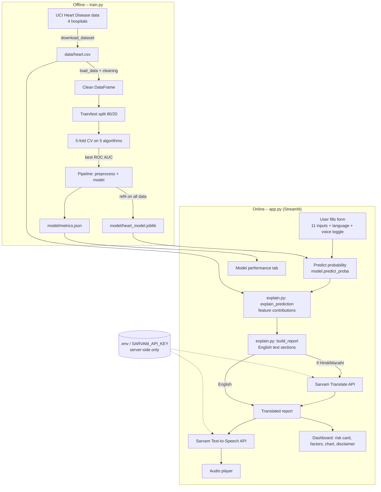

# ❤️ Heart Disease Risk Predictor — Explainable, Multilingual & Voice-enabled

A Streamlit web app that estimates a person's probability of heart disease from 11 routine
clinical inputs, **explains why** the model gave that result, and presents the explanation in
**English, Hindi (हिन्दी) or Marathi (मराठी)** — in text and in a natural-sounding **voice** —
using Sarvam AI.

> ⚠️ Educational project only. It is **not** a medical diagnosis. Always consult a doctor.

---

## Table of contents
1. [Problem statement](#1-problem-statement)
2. [Proposed solution](#2-proposed-solution)
3. [Architecture](#3-architecture)
4. [Tech stack](#4-tech-stack)
5. [Project structure](#5-project-structure)
6. [File-by-file: purpose and operations](#6-file-by-file-purpose-and-operations)
7. [Dataset](#7-dataset)
8. [Model training and results](#8-model-training-and-results)
9. [Explainable AI method](#9-explainable-ai-method)
10. [Multilingual text and voice (Sarvam AI)](#10-multilingual-text-and-voice-sarvam-ai)
11. [Setup and running](#11-setup-and-running)
12. [Security and API key handling](#12-security-and-api-key-handling)
13. [Improvements over the original notebook](#13-improvements-over-the-original-notebook)
14. [Limitations and future work](#14-limitations-and-future-work)

---

## 1. Problem statement

Heart disease is one of the leading causes of death worldwide. Early risk screening is cheap
when it relies on routine measurements (blood pressure, cholesterol, ECG, etc.), yet:

1. **Black-box predictions.** Most ML demos output only "0" or "1". A patient (or a doctor)
   cannot tell *which* inputs drove the result, so the output is hard to trust or act upon.
2. **Language barrier.** Medical explanations are typically in English, while many patients in
   India are most comfortable in Hindi or Marathi. Text-only output also excludes people with
   low literacy.
3. **Data and engineering pitfalls in the original notebook** — decimals truncated, impossible
   zero values used as real readings, hand-built dummy columns that could drift between
   training and prediction, and only a hard 0/1 label with no probability.

**Goal:** build a reliable, understandable and accessible heart-disease risk screening tool.

## 2. Proposed solution

| Need | Solution in this project |
|---|---|
| Reliable prediction | Clean the data, compare 5 algorithms using 5-fold cross-validation, keep the best one, and save **one** scikit-learn pipeline (preprocessing + model). |
| Not just yes/no | The model returns a **probability**, shown as a risk band: Low (<35%), Moderate (35–65%), High (>65%). |
| Explainability (XAI) | A model-agnostic, per-patient **feature-contribution analysis** shows how many percentage points each input raised or lowered the risk, as a chart and as plain sentences. |
| Local-language access | The English report is translated to Hindi/Marathi with the **Sarvam AI Translate API**. |
| Voice | The translated explanation is read aloud using **Sarvam AI Text-to-Speech (bulbul:v3)**. |
| Privacy of credentials | The API key lives only on the server (`.env`/environment variable), is git-ignored, and is never displayed in the UI. |

## 3. Architecture



**Request flow (one prediction):**
1. User submits the form → inputs stored in `st.session_state` (so the result survives language changes).
2. `explain_prediction` computes the probability and the contribution of each input.
3. `build_report` creates structured English text (inputs, result, factors up/down, disclaimer).
4. If Hindi/Marathi is selected, every text piece is translated in parallel via Sarvam (cached).
5. The dashboard renders the risk card, factor lists, bar chart and disclaimer.
6. If voice is on, the script is converted to speech (chunked, cached) and played automatically.

## 4. Tech stack

| Layer | Technology | Why |
|---|---|---|
| Language | Python 3 | ML ecosystem |
| Web UI | **Streamlit** | Fast interactive dashboards: forms, tabs, charts, audio |
| ML | **scikit-learn** | Pipelines, ColumnTransformer, models, metrics, CV |
| Data | **pandas, NumPy** | Cleaning and tabular manipulation |
| Persistence | **joblib** | Saves the whole trained pipeline |
| Models compared | Logistic Regression, Random Forest, Gradient Boosting, KNN, SVM (RBF, probability-calibrated) | Fair comparison on same CV folds |
| Explainability | Custom occlusion/marginal-effect analysis (model-agnostic) | Works for any classifier with `predict_proba` |
| Translation | **Sarvam AI Translate** (`sarvam-translate:v1`) | High-quality Indian-language translation |
| Voice | **Sarvam AI Text-to-Speech** (`bulbul:v3`) | Natural Indian-language voices |
| HTTP / TLS | `urllib` + `certifi` | No extra dependency, reliable certificates on macOS |
| Concurrency | `concurrent.futures.ThreadPoolExecutor` | Parallel translation calls |
| Version control | Git / GitHub | Source hosting |

## 5. Project structure

```
ML PROJECT/
├── app.py                    Streamlit web app (UI + orchestration)
├── explain.py                Explainability, report building, Sarvam translation + voice
├── train.py                  Data download/cleaning, model comparison, model saving
├── requirements.txt          Python dependencies
├── README.md                 This document
├── HeartdiseaseFinal.ipynb   Original exploration notebook
├── data/
│   └── heart.csv             918-patient dataset
├── model/
│   ├── heart_model.joblib    Saved pipeline (preprocessing + best model)
│   └── metrics.json          Test metrics + cross-validation scores
├── .gitignore                Excludes .venv, __pycache__, .DS_Store, .env
└── .env                      (local only, not in git) SARVAM_API_KEY=...
```

## 6. File-by-file: purpose and operations

### `train.py` — model training
**Purpose:** produce the saved model and its evaluation. Run with `python train.py`; `app.py`
also calls it automatically if no model file exists.

Operations, in order:
1. **Constants:** paths (`DATA_PATH`, `MODEL_PATH`, `METRICS_PATH`), column lists
   `NUMERIC` (Age, RestingBP, Cholesterol, MaxHR, Oldpeak) and `CATEGORICAL` (Sex,
   ChestPainType, FastingBS, RestingECG, ExerciseAngina, ST_Slope), `TARGET = HeartDisease`.
2. **`download_dataset()`** — downloads the four UCI files (Cleveland, Hungarian, Switzerland,
   VA) over verified TLS (`certifi`), concatenates them, renames and decodes the codes into
   readable categories (e.g. `cp 4 → ASY`, `sex 1 → M`), converts the target to binary
   (`num > 0 → 1`) and writes `data/heart.csv`.
3. **`load_data()`** — reads the CSV; treats `0` cholesterol / blood pressure as **missing**
   (impossible values); converts `FastingBS` to a categorical string; drops rows without a
   label and removes duplicates.
4. **`build_preprocessor()`** — a `ColumnTransformer`:
   numeric → median imputation + standard scaling; categorical → most-frequent imputation +
   one-hot encoding (`handle_unknown="ignore"`).
5. **`CANDIDATES`** — the five algorithms compared.
6. **`main()`**
   - stratified 80/20 train/test split (`random_state=42`);
   - 5-fold stratified cross-validation (ROC AUC) of each candidate inside its own pipeline
     (no data leakage);
   - picks the highest mean CV ROC AUC;
   - fits it on the training split and evaluates on the held-out test split
     (accuracy, precision, recall, F1, ROC AUC, confusion matrix);
   - **refits on all data** for the final model;
   - saves `model/heart_model.joblib` and `model/metrics.json`.

### `explain.py` — explainability, translation and voice
**Purpose:** all logic that is independent of the UI.

| Function / constant | Operation |
|---|---|
| `LANGUAGES` | Maps display names to Sarvam codes: `en-IN`, `hi-IN`, `mr-IN`. |
| `FEATURE_LABEL`, `VALUE_TEXT`, `UNITS`, `format_value()` | Convert raw values (`ASY`, `M`, `1`) into readable English such as "Asymptomatic", "Male", "above 120 mg/dL", with units. |
| `explain_prediction(model, row)` | Samples 150 training patients as a background; for each of the 11 features, gives every background patient *this patient's* value for that feature and measures the mean change in predicted probability vs. the untouched background. Returns the probability and a table of contributions sorted by absolute size. |
| `band(proba)` | Converts probability to Low / Moderate / High text. |
| `build_report(row, proba, contrib)` | Builds the English report: inputs summary, result, up to 5 top factors split into "increased risk" / "decreased risk" sentences (ignores effects smaller than 0.5 points) and a disclaimer. |
| `get_api_key()` | Reads `SARVAM_API_KEY` from the environment, or from the local `.env` file. |
| `_translate_one()` | One call to `POST https://api.sarvam.ai/translate` (`sarvam-translate:v1`) with the `api-subscription-key` header; converts HTTP errors into readable messages. |
| `translate_report()` | Flattens the report, translates all pieces in parallel (6 threads) and rebuilds the same structure. Returns the original if English. |
| `speech_script()` | Chooses what is spoken: result, factors up/down, disclaimer (not the raw inputs list). |
| `text_to_speech()` | Splits text into ≤1500-character chunks, calls `POST /text-to-speech` (`bulbul:v3`, speaker `priya`), decodes the base64 WAV and stitches chunks into one WAV. |

### `app.py` — Streamlit application
**Purpose:** user interface and orchestration.

Operations, in order:
1. Page configuration and custom CSS (gradient hero, coloured result cards for low / moderate / high).
2. **`load_model()`** (cached with `st.cache_resource`) — trains if needed, loads the pipeline and metrics.
3. **Sidebar** — language radio (English / हिन्दी / मराठी), "read aloud" toggle, and a note
   that translation/voice use Sarvam AI. The API key is **never** displayed or requested.
4. **`cached_translation()` / `cached_speech()`** (`st.cache_data`) — identical text is translated or voiced only once.
5. **Predict tab**
   - Form with 11 inputs (sliders, selects, number boxes) and a **Predict risk** button.
   - On submit, stores the inputs in `st.session_state["row"]`.
   - Computes probability + contributions, builds the English report, translates it if needed
     (falls back to English with a warning if translation fails).
   - Displays: translated inputs summary, coloured probability card with progress bar, lists of
     factors raising/lowering risk, a bar chart of contributions in percentage points, the disclaimer, and the audio player (autoplay).
6. **Model performance tab** — shows the selected model, accuracy/precision/recall/F1/ROC AUC,
   the confusion matrix and a bar chart of cross-validated ROC AUC for every algorithm.

### `requirements.txt`
`streamlit`, `pandas`, `numpy`, `scikit-learn`, `joblib`, `certifi`. (Sarvam calls use the
standard library, so no extra package is required.)

### `data/heart.csv`
918 de-duplicated patient records with the 11 inputs and the `HeartDisease` target.

### `model/heart_model.joblib`
The serialized scikit-learn `Pipeline` (preprocessor + best model). Loaded by `app.py`.

### `model/metrics.json`
Evaluation output used by the *Model performance* tab.

### `HeartdiseaseFinal.ipynb`
The original exploration notebook (kept for reference; the production code is in `train.py`).

### `.gitignore`
Prevents `.venv/`, `__pycache__/`, `.DS_Store` and **`.env`** from being committed.

### `.env` (local only)
Contains `SARVAM_API_KEY=...`. Not tracked by git.

## 7. Dataset

UCI Heart Disease repository (Cleveland, Hungary, Switzerland, VA Long Beach), 918 unique
patients, same schema as the Kaggle "Heart Failure Prediction" dataset.

| Feature | Meaning |
|---|---|
| Age | years |
| Sex | M / F |
| ChestPainType | TA typical angina, ATA atypical angina, NAP non-anginal, ASY asymptomatic |
| RestingBP | resting blood pressure (mm Hg) |
| Cholesterol | serum cholesterol (mg/dL) |
| FastingBS | fasting blood sugar > 120 mg/dL (1/0) |
| RestingECG | Normal, ST (ST-T abnormality), LVH |
| MaxHR | maximum heart rate achieved |
| ExerciseAngina | exercise-induced angina (Y/N) |
| Oldpeak | ST depression induced by exercise |
| ST_Slope | Up, Flat, Down |
| **HeartDisease** | target: 1 = disease, 0 = no disease |

## 8. Model training and results

5-fold cross-validated ROC AUC (training set):

| Algorithm | CV ROC AUC |
|---|---|
| **Logistic Regression (selected)** | **0.867** |
| Random Forest | 0.863 |
| SVM (RBF, calibrated) | 0.856 |
| KNN | 0.853 |
| Gradient Boosting | 0.852 |

Held-out test set (184 patients): accuracy **79.9%**, precision 80.4%, recall 84.3%,
F1 82.3%, ROC AUC **0.889**. Confusion matrix: 61 true negatives, 21 false positives,
16 false negatives, 86 true positives.

## 9. Explainable AI method

For a patient *p* and feature *f*:

```
contribution(f) = mean over background patients b of  P(disease | b with f := p[f])
                  − mean over background patients b of  P(disease | b)
```

* Positive → the patient's value for *f* pushes risk **up** versus a typical patient.
* Negative → it pushes risk **down**.
* Model-agnostic (only `predict_proba` is needed) and fully local — no extra library.
* Contributions are marginal, one-feature-at-a-time effects; they approximate, but are not
  identical to, SHAP values, and interactions between features are not separated.

## 10. Multilingual text and voice (Sarvam AI)

* **Translation:** `POST https://api.sarvam.ai/translate`, model `sarvam-translate:v1`,
  English (`en-IN`) → Hindi (`hi-IN`) or Marathi (`mr-IN`).
* **Voice:** `POST https://api.sarvam.ai/text-to-speech`, model `bulbul:v3`, speaker `priya`.
* Results are cached; failures degrade gracefully to English text / no audio with a message.

## 11. Setup and running

```bash
python3 -m venv .venv
source .venv/bin/activate
pip install -r requirements.txt

# create the (git-ignored) key file for translation + voice
echo "SARVAM_API_KEY=your_key_here" > .env

python train.py            # optional: the app trains automatically on first launch
streamlit run app.py       # opens http://localhost:8501
```

Usage: choose the language in the sidebar → enter the 11 inputs → **Predict risk** →
read/listen to the explanation. Use the *Model performance* tab for evaluation details.
Without a key the app still works in English text (translation and voice are skipped).

## 12. Security and API key handling

* The key is read only from the `SARVAM_API_KEY` environment variable or the local `.env` file.
* `.env` is listed in `.gitignore`; the key was verified to be absent from all git history.
* The key is never rendered in the dashboard and there is no input box for it.
* If a key is ever exposed (chat, screenshot, commit), **revoke and regenerate it** in the Sarvam dashboard.

## 13. Improvements over the original notebook

| Problem | Fix |
|---|---|
| `astype(int)` truncated Oldpeak (1.5 → 1) | Decimals kept |
| Cholesterol / BP of 0 treated as real values | Treated as missing and imputed |
| App hand-built dummy columns that could drift from training | One saved `Pipeline` does all encoding |
| Only a 0/1 label | Probability, risk band and explanations |
| Model chosen from a single split | 5-fold cross-validation selects the model |
| Pickles tied to a specific scikit-learn version | Retrained with the installed version |
| No explanation / English only / text only | XAI + Hindi/Marathi + natural voice |

## 14. Limitations and future work

* ~900 patients from four hospitals; not representative of every population; not clinically validated.
* The explanation shows statistical association, **not causation**.
* Translation of medical wording should be reviewed by a clinician before real-world use.
* Ideas: SHAP values, probability calibration plots, more languages (Sarvam supports many),
  speech input, Docker/Streamlit Cloud deployment with secrets management.
